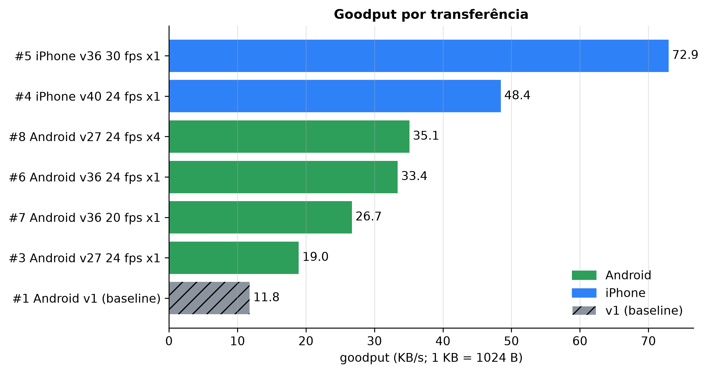
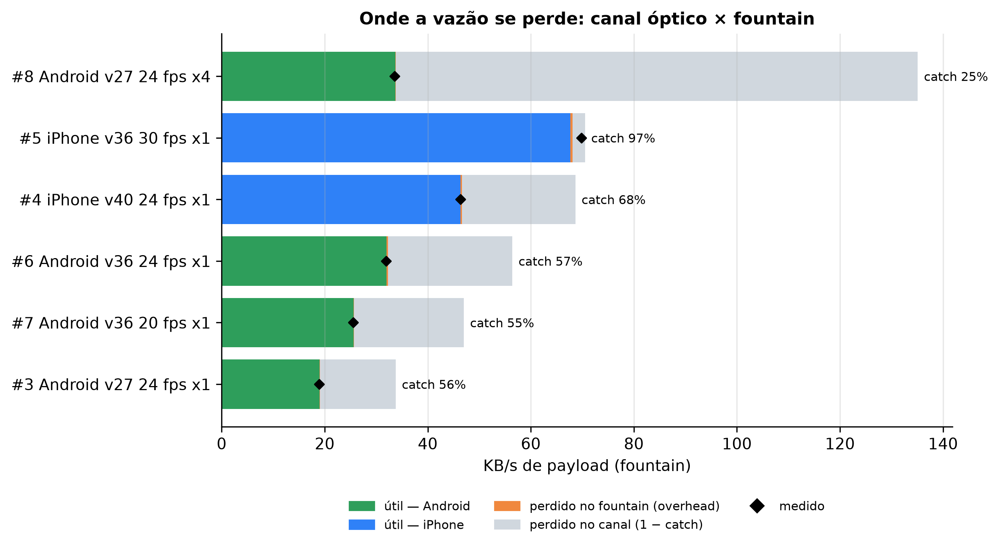
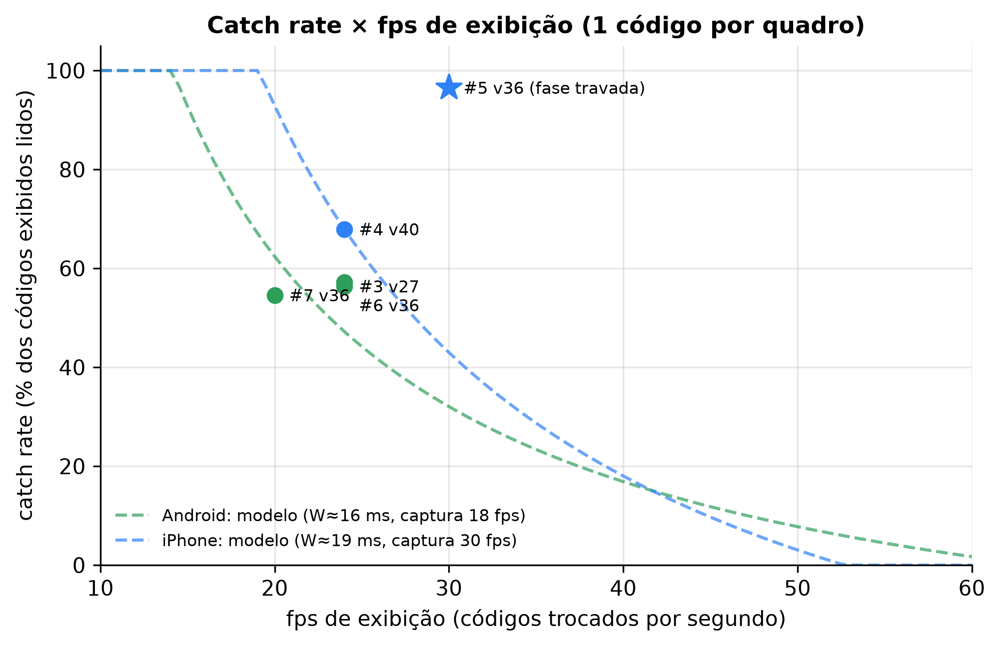
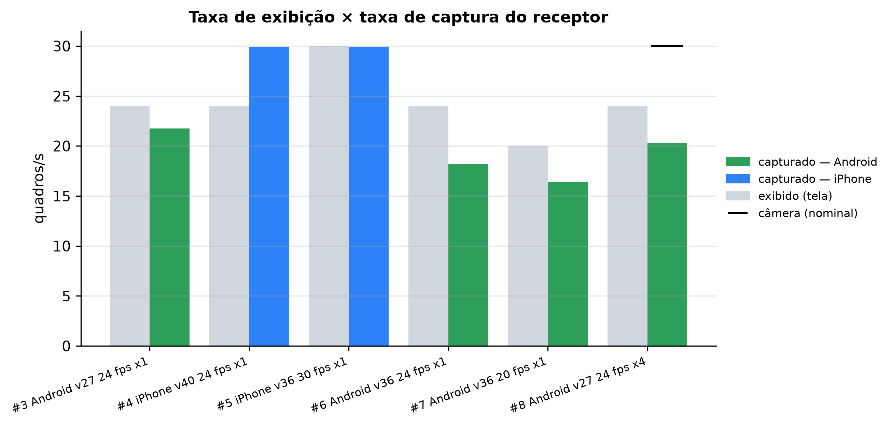
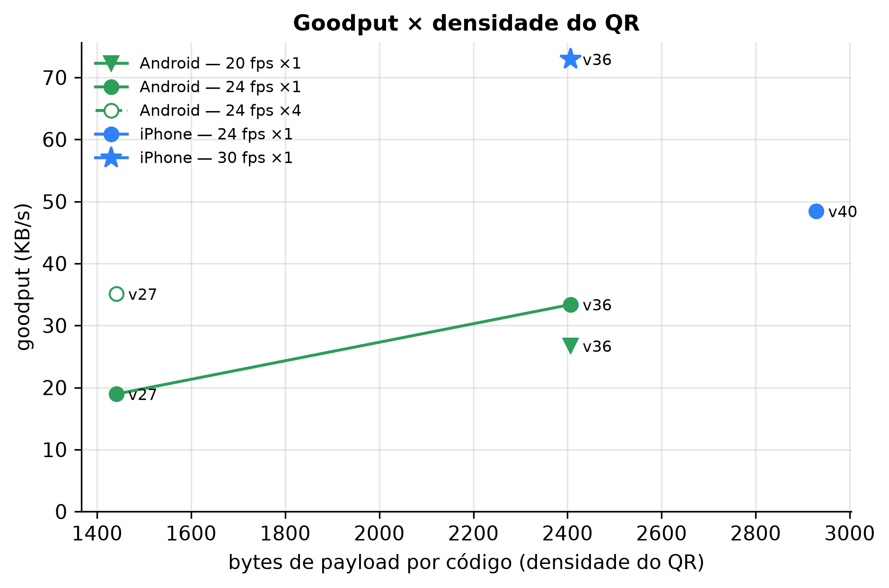
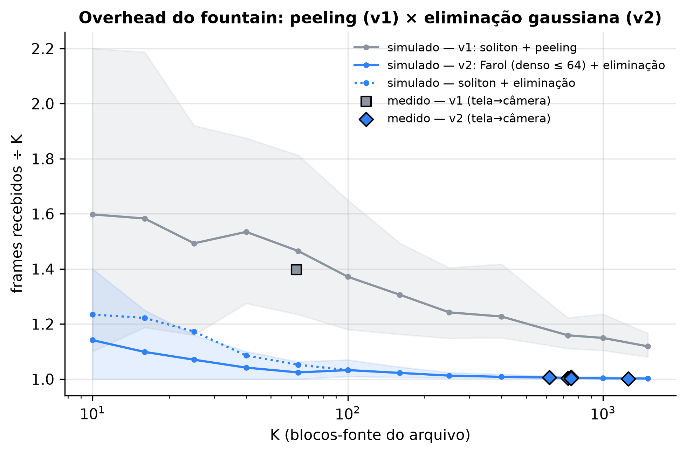

# Análise dos relatórios e roteiro de testes — Farol

Documento de trabalho do TCC: o que os relatórios de 31/10/2026 mostram, o que ainda
não dá para afirmar, e o roteiro de testes para fechar essas lacunas. As figuras são
geradas pelo harness (`analysis/`) e ficam em [figuras/](figuras/).

```bash
cd analysis
.venv/bin/python -m farol_analysis reports ../docs/figuras   # Windows: .venv\Scripts\python
```

---

## 1. Análise dos relatórios de 31/10

### 1.1 Dados
11 relatórios em `analysis/reports/`: 1 do protocolo v1 (27/09, linha de base) e 10 do v2.

- **3 descartados**: re-exportações feitas pelo botão "Exportar diagnóstico" *depois* de
  concluir (mesma sessão, `fileBytes = 0`, `goodput = 0`). Bug corrigido: o botão some
  ao concluir e o harness ignora esse tipo de arquivo.
- **1 fora das médias**: arquivo de 4,9 KB (K = 2) — termina em 2 quadros, o "goodput"
  de 90 KB/s não mede nada. O número útil é o **tempo total: 1,7 s** (1,6 s de aquisição).
- **Restam 6 transferências v2 de arquivos grandes** (K = 617–1254) + a linha de base v1.

Montagem: emissor MacBook (Chrome 156, tela 120 Hz) → receptores Android (Chrome 156) e
iPhone (Safari 26.6), celular em **retrato** (1080×1920), ECC L, 1 código por quadro —
exceto o #8, o primeiro com **4 códigos** (grade 2×2).

| # | aparelho | QR | B/código | fps tela | fps captura | catch | hit | overhead | goodput (KB/s) |
|---|---|---|---:|---:|---:|---:|---:|---:|---:|
| 1 | Android | v1 | — | — | 28,1 | — | 42% | 1,397 | 11,8 |
| 3 | Android | v27 | 1441 | 24 | 21,7 | 56% | 62% | 1,004 | 19,0 |
| 4 | iPhone | v40 | 2929 | 24 | 29,9 | 68% | 54% | 1,006 | 48,4 |
| 5 | iPhone | v36 | 2407 | 30 | 29,9 | 97% | 100% | 1,007 | **72,9** |
| 6 | Android | v36 | 2407 | 24 | 18,2 | 57% | 75% | 1,008 | 33,4 |
| 7 | Android | v36 | 2407 | 20 | 16,4 | 55% | 66% | 1,003 | 26,7 |
| 8 | Android | v27 ×4 | 4×1441 | 24 | 20,3 | 25% | 29% | 1,002 | 35,1 |

*catch* = códigos distintos lidos ÷ códigos exibidos enquanto o receptor olhava;
*hit* = códigos novos ÷ (capturas × códigos por quadro); KB = 1024 B.

### 1.2 Resultados

**R1 — O fountain deixou de ser gargalo.** Overhead de **1,002–1,008** com K = 617–1254,
zero ou um quadro redundante, contra 1,40 do protocolo v1 (K = 63). Vale também acima do
teto de 1024 incógnitas da eliminação (#8, K = 1254: 1,002). Os pontos medidos caem em
cima da curva simulada (Fig. 6): a eliminação gaussiana entrega no campo o que a
simulação previa.

**R2 — A vazão se perde no canal óptico.** Toda transferência obedece a
`goodput = fps de tela × bytes por código × catch ÷ overhead` (identidade contábil;
fecha com o medido em até 3%). Com 1 código por quadro e catch de 55–68%, **32–45% da
taxa oferecida pela tela se perde na captura** (75% no #8); o fountain perde menos de 1%
(Fig. 2). Melhorar a vazão agora significa melhorar o catch ou a taxa oferecida, não o
código.

**R3 — O fps de tela em relação à câmera decide o catch.** No iPhone (câmera a 30 fps):
24 fps → catch 68% e **zero leituras duplicadas** em 1140 capturas; 30 fps → catch 97% e
hit 100%. Zero duplicatas com mais capturas (30/s) que códigos (24/s) só acontece se
cada código tiver no máximo uma captura limpa — ou seja, existe uma **janela W ao redor
de cada troca de código** em que a captura sai misturada (exposição + rolling shutter +
tempo de resposta do painel). Modelo de captura assíncrona:

$$\text{catch} \approx \min\!\left(1, \frac{T_{tela} - W}{T_{captura}}\right)$$

Ajustado nos runs assíncronos: **W ≈ 19 ms (iPhone)** e **10–17 ms (Android)** (Fig. 3).
O run a 30 fps ficou acima da curva porque câmera e tela rodavam na *mesma* taxa
(29,9 × 30,0): a fase entre elas quase não anda durante a transferência, e calhou de
ser boa. Pelo modelo, isso é **sorte, não regra** — na fase ruim o mesmo ajuste perderia a
maior parte dos códigos.

Previsões do modelo para o iPhone (testáveis no E1):

| fps de tela | 15 | 20 | 24 | 30 | 40 |
|---|---:|---:|---:|---:|---:|
| catch previsto | 100% | 93% | 68% (ponto do ajuste) | bimodal, média ~43% | 18% |
| códigos lidos/s | 15 | **18,6** | 16,3 | 0–29 | 7 |

Ou seja: **20 fps deve ser o ponto ótimo robusto** para uma câmera de 30 fps; 30 fps pode
render mais, mas não é reprodutível.

**R4 — O Android é limitado pela captura.** Ele processa só 16–22 quadros/s, menos do que
a tela exibe (20–24), então perde códigos mesmo com decodificação perfeita (Fig. 4).
Causa provável: em retrato o quadro de 1080×1920 vai inteiro (2 MP) para o decoder — o
limite de 1280 px do receptor vale só para a *largura*. Hipótese testável com
`?decode=1280` (E3).

**R5 — Densidade foi "de graça" no Android.** A 24 fps, de v27 para v36 (+67% de bytes
por código) o goodput subiu 76% (19,0 → 33,4 KB/s) com o mesmo catch (56% → 57%)
(Fig. 5). Ainda não sabemos onde a resolução por módulo começa a derrubar o catch (E2).

**R6 — Evolução.** Melhor run: **72,9 KB/s** (iPhone, v36, 30 fps) — 6,2× a linha de base
v1 (11,8 KB/s). Comparação indicativa: arquivos, K e aparelhos diferentes (Fig. 1).

**R7 — Aquisição.** Câmera ligada → primeiro código: 0,2–3,7 s. Um run teve 19,6 s
(operador apontando depois de ligar a câmera) — controlar no protocolo.

**R8 — Vários códigos: a tela oferece 4×, o celular lê 1,2 por captura.** No #8 (Android,
4 × v27, 24 fps) a tela ofereceu 135 KB/s, mas cada captura leu em média **1,2 dos 4
códigos** (catch 25%): 35,1 KB/s — 1,85× o mesmo QR com 1 código (#3), empatado com 1
código v36 (#6). Em retrato a grade 2×2 (266 módulos de lado) divide os 1080 px de
largura: se a tela inteira cabia no quadro, são ~2,5 px por módulo, pouco para o decoder.
O E4 testa o celular na horizontal, QR menos denso e 2 códigos.

### 1.3 Limitações (vale citar no TCC)
- **n = 1 por configuração** e variáveis confundidas (aparelho, densidade e fps mudaram
  juntos). W do iPhone vem de um único run (o harness estima W por run: coluna `W ms`).
- Vieses corrigidos em 31/10, que só valem para relatórios **novos**: a duração contava a
  partir da *decodificação* do primeiro código (não da captura) — com os workers ainda
  compilando o wasm, isso inflou o goodput do run #5 em ~3%; `hit` passava de 100% em
  arquivos minúsculos; o refresh do emissor aparecia como 120,48 Hz (timestamps do Chrome
  têm resolução de 0,1 ms — o harness corrige para 120 Hz nos relatórios antigos).
- Vários códigos por quadro: **um único run** (#8, em retrato, já com as correções de
  medição) — o efeito do número de códigos ainda não foi isolado.

### 1.4 Figuras

**Fig. 1 — Goodput por transferência** (resultados: evolução v1 → v2)



**Fig. 2 — Taxa oferecida pela tela = útil + perda no fountain + perda no canal** (resultados: onde está o gargalo)



**Fig. 3 — Catch × fps de tela, com o modelo de captura assíncrona** (modelo do canal tela→câmera;
só runs com 1 código por quadro)



**Fig. 4 — fps exibido × fps processado pelo receptor** (gargalo do receptor Android)



**Fig. 5 — Goodput × bytes por código** (escolha da densidade do QR)



**Fig. 6 — Overhead do fountain × K: peeling (v1) × eliminação (v2), simulado e medido** (método:
decodificação do fountain; a simulação está em `analysis/farol_analysis/fountain_sim.py`)



---

## 2. Roteiro de testes

### 2.1 Hipóteses
| | Hipótese | Experimento |
|---|---|---|
| H1 | Com câmera a 30 fps, 20 fps de tela maximiza os códigos lidos/s de forma reprodutível; 30 fps é bimodal | E1 |
| H2 | Aumentar bytes por código aumenta o goodput até a resolução por módulo cair abaixo de ~3 px | E2 |
| H3 | No Android, decodificar em resolução menor aumenta a taxa de captura e o catch | E3 |
| H4 | N códigos por quadro multiplicam o goodput até a resolução ou a decodificação saturarem | E4 |
| H5 | O overhead do fountain fica ≤ 1,05 para K ≥ 64, em qualquer condição de canal | E5 (e todos) |
| H6 | Câmera a 60 fps (iPhone) dobra a taxa de captura e desloca o fps ótimo de tela | E6 |

### 2.2 Montagem (igual em todos os testes)
- **Emissor**: o mesmo MacBook, Chrome, tela 120 Hz, brilho máximo, Night Shift/True Tone
  desligados, aba do `/send/` visível e em **Tela cheia**, sem outras abas pesadas.
- **Receptor**: celular **num suporte** (nada de mão: o foco caça com o tremor), distância
  tal que o código ocupe ~80% da largura do quadro — marque a posição na mesa. Retrato,
  salvo no E4.
- **Luz**: a mesma iluminação ambiente em todas as sessões (anote).
- **Arquivo**: sempre o **Benchmark 1 MB** (payload fixo, K = 436 em v36, 728 em v27), salvo no E5.
- **Software**: o site publicado na Vercel (README, Opção 0), com a chave aberta uma vez
  em cada aparelho — **emissor e receptor no mesmo site**, para o relatório sair com as
  configurações do emissor. Alternativa: `npm run dev` + túnel (relatórios vão direto
  para `analysis/reports/`).

### 2.3 Procedimento de cada run
1. No `/send/`: ajuste fps, densidade (versão do QR), ECC = L e códigos por quadro;
   clique **Benchmark 1 MB** e depois **⛶ Tela cheia**.
2. No celular, abra o receptor **com a tag do run** (o celular já posicionado):
   `https://<projeto>.vercel.app/receive/?tag=e1-ios-fps20-r1`
3. Toque **Iniciar câmera** e não mexa até o "SHA-256 OK".
4. Confira que **não** apareceu download de JSON no celular (se apareceu, a chave não está
   salva nesse navegador: abra `/receive/?key=…` de novo). No dev server, confira a linha
   `[farol] relatório …` no terminal do Vite.
5. Recarregue a página do receptor antes do próximo run.

Tags: `<experimento>-<aparelho>-<config>-r<N>` (só letras, números, `-`, `_`, `.`). O harness
agrupa as repetições pela tag sem o `-rN` e mostra média ± desvio.

Parâmetros de URL do receptor (todos opcionais e gravados no relatório):

| parâmetro | efeito | exemplo |
|---|---|---|
| `tag` | rótulo do run | `tag=e3-and-dec1280-r2` |
| `decode` | maior lado (px) do quadro entregue ao decoder | `decode=1280` |
| `fps` | taxa da câmera (pede exata, cai para a mais próxima) | `fps=60` |
| `res` | altura da câmera (16:9) | `res=720` |

**Repetições**: 3 por configuração (5 no ponto bimodal de 30 fps). Alterne a ordem das
configurações entre repetições, para aquecimento do celular não virar efeito.

### 2.4 Experimentos

**E0 — Ruído de medição.** Android e iPhone, v36, 24 fps, ×1, **5 repetições**. Dá o desvio
padrão de referência: diferenças menores que ~2 desvios nos outros testes não contam.

**E1 — fps de tela (H1).** v36, ×1, ambos os aparelhos; fps ∈ {15, 20, 24, 30, 40}
(no emissor de 120 Hz todos são divisores exatos). 3 repetições; **5 em 30 fps**.
Tags: `e1-ios-fps20-r1`, `e1-and-fps30-r4`…
*Esperado (iPhone)*: catch ≈ 100 / 93 / 68 / bimodal / 18%. Rejeita H1 se 30 fps der
catch alto em todas as 5 repetições.

**E2 — densidade (H2).** No melhor fps do E1; QR v27, v33, v36, v40; ×1; ambos.
Tags: `e2-and-v40-r1`. Anote o catch: o ponto em que ele cai é o limite de resolução.

**E3 — resolução de decode no Android (H3).** v36, 20 fps, ×1; `decode` ∈ {sem parâmetro
(1080×1920), 1600, 1280, 960}. Tags: `e3-and-dec1280-r1`. Olhe `fps captura` (Fig. 4) e catch.

**E4 — códigos por quadro (H4).** Celular **na horizontal** (câmera 1920×1080, cada
código fica com mais pixels); ×1, ×2, ×4; QR v27 e v36; melhor fps do E1; ambos. Tags:
`e4-ios-v27-x4-r1`. Com 4 códigos cada QR ocupa ~metade da altura: comece por v27.

**E5 — tamanho do arquivo (H5).** Melhor configuração; arquivos de 5 KB, 50 KB, 500 KB,
1 MB e 5 MB (incompressíveis, ex.: zip). Tags: `e5-ios-500k-r1`. Interessa o **overhead** e o
**tempo total** (aquisição + transferência): em arquivo pequeno quem manda é a latência.
Acima de 1024 blocos a eliminação só entra no fim (veja o overhead do arquivo de 5 MB).

**E6 — câmera 60 fps no iPhone (H6).** `?fps=60&res=720`; tela a 30, 40 e 60 fps; v27
(720p tem menos pixels). Tags: `e6-ios-cam60-fps40-r1`. Confira no relatório
(`cameraFps`) se o iPhone entregou mesmo 60.

**E7 — robustez (opcional).** No melhor setup: mão × suporte, luz acesa × apagada,
brilho 50% × 100%, código ocupando 50% × 80% da largura. 3 repetições cada.

### 2.5 Análise
```bash
npm run reports:pull                      # site publicado: baixa os relatórios novos
cd analysis
.venv/bin/python -m farol_analysis reports ../docs/figuras
```
- **Tabela por run** e **tabela por configuração** (média ± desvio, agrupada pela tag):
  são as tabelas do capítulo de resultados.
- **Diagnóstico** aponta travamento do emissor, captura limitada, fase travada e K pequeno.
- Figuras: Fig. 3 responde H1 (os pontos novos devem cair na curva; a curva usa a mediana de W),
  Fig. 5 responde H2, Fig. 4 responde H3, Fig. 1/2 respondem H4, Fig. 6 responde H5.
- Relatórios com `stalls > 0` no emissor devem ser refeitos, não descartados em silêncio.

### 2.6 Checklist de sessão
- [ ] site publicado aberto nos dois aparelhos (chave já salva) — ou `npm run dev` + túnel
- [ ] emissor: brilho máximo, tela cheia, aba visível
- [ ] receptor recarregado (protocolo v2) e no suporte, posição marcada
- [ ] tag do run conferida na barra de endereço
- [ ] nenhum JSON baixado no celular após cada run; no fim, `npm run reports:pull`
